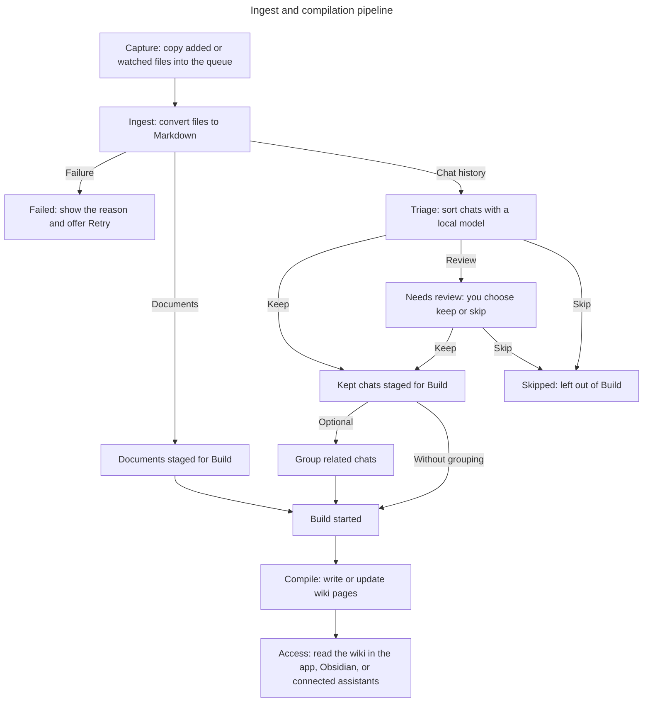
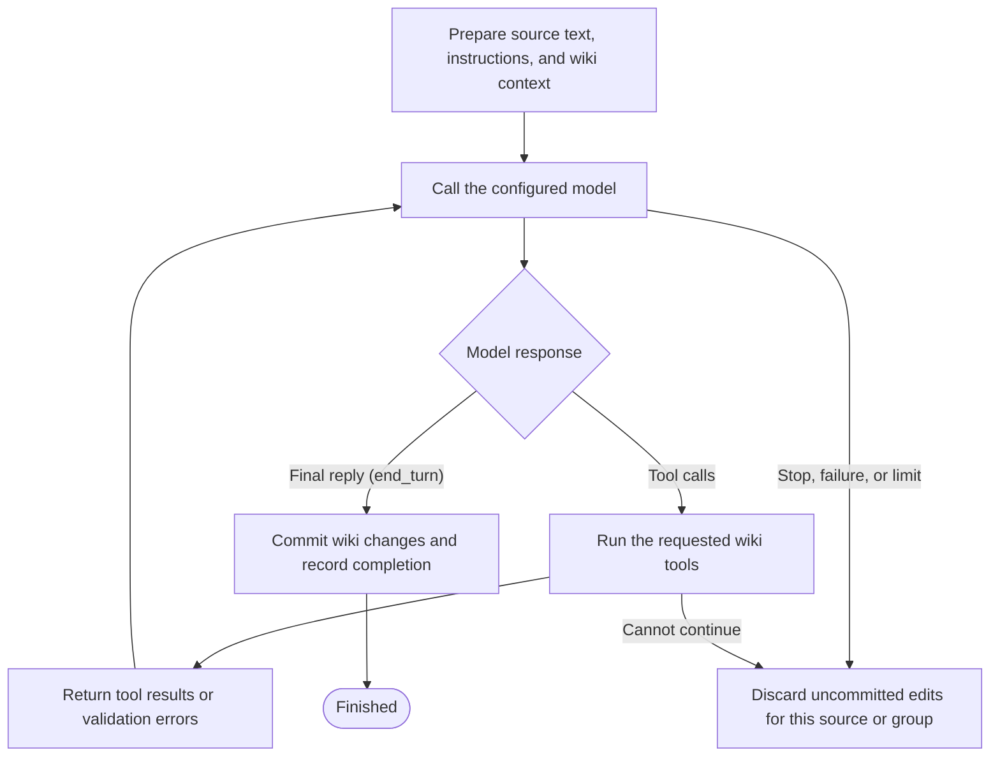

# Architecture

A local Django backend manages vault files, database records, and background jobs. The macOS app, CLI, and MCP adapter call its Django Ninja API over localhost HTTP. The app receives state updates through server-sent events (SSE).

The backend runs ingestion and compilation in separate worker processes. Documents and chat history follow different paths through these stages:

- **Documents:** capture → ingest → stage → compile → access.
- **Chats:** capture → ingest → triage → stage kept chats → optionally group → compile → access.

**Ingest** converts files to Markdown. **Triage** sorts chats into keep, review, or skip. **Staged** sources are ready to build; **compile** means turning them into wiki pages. Ingestion happens automatically, and compilation starts when you choose **Build wiki**. Only chats go through triage and optional grouping in the default configuration.



Grouping can be previewed before a build or performed when the build starts. Documents compile individually in either case. The [compilation agent loop](#compilation-agent-loop) below shows what happens inside Compile.

## Stages

### Capture

Material enters either by being dropped onto the menu bar window or copied into `~/second-brain/drops/`. The backend validates the selection and copies inputs into a drop folder, preserving originals. A ChatGPT export is detected by its usual JSON shape and routed to `drops/chatgpt/`, while other supported files go to `drops/documents/`. Any enabled watched folders are periodically scanned, and new or modified files are copied into `drops/<source name>/` for ingestion. The manifest database remembers the original path and captured hash to avoid reingesting the same unmodified file.

### Ingest

Ingestion converts each source to Markdown under `~/second-brain/raw/`, mirroring the source layout (`raw/documents/`, `raw/chatgpt/`, and so on). The parser is chosen per file:

- PDFs are classified one page at a time. Born-digital pages go to Docling; handwritten or scanned pages go to Chandra. A document that mixes the two is parsed by both and stitched back together in reading order.
- Plain text (`.md`, `.txt`, `.tex`) passes through with light front-matter added.
- A ChatGPT export is split into one Markdown file per conversation.

A SQLite manifest records what has been ingested so unchanged files are skipped on the next run. Files that fail parsing stay in `drops/` with a recorded error. Automatic scans skip unchanged failed files until they are explicitly retried; changed files are eligible on the next scan.

### Triage

Bulk chat history is noisy. Conversations can be small talk, one-off lookups, or abandoned tangents, so compilation might be wasted on pages worth nothing. During ingestion (before anything reaches the paid compilation step), a small local model (Gemma, via Ollama) reads each new chat and labels it kept, review, or skip.

By default, only imported ChatGPT conversations are triaged. Other documents are staged immediately after parsing. Chats marked review are copied into `~/second-brain/inbox/` and wait for a Keep or Skip decision.

When triage is enabled, chats awaiting a decision are left out of builds. If Ollama stops responding, triage stops and the remaining chats wait to be triaged on the next run, and a chat the model can't score goes to review for you to decide.

### Compile

Building the wiki is the only stage that calls a hosted model and thus costs money. Two things happen here: planning, then synthesis.

Planning is optional and exists to fight redundancy. Years of chats might circle the same topics (e.g. multiple conversations talking about gradient descent); compiling each of these on their own is likely to be wasteful and result in overlapping pages that would hinder the quality of the wiki. Thus, a clustering step groups related chats first so a topic can become one page instead of many. It embeds each staged chat locally and groups similar conversations. Documents compile individually by default. You can preview a grouping before spending anything, adjust it in the app, and the build honors the plan you reviewed (see [using the app](using-the-app.md#building-the-wiki)). If automatic grouping is enabled, a build can also group chats when no reviewed plan exists.

Synthesis is done by a compilation agent: the configured model requests tools, and the compiler runs those tools and returns their results. Each agent conversation handles one document, one chat, or a group of related chats. It writes or updates wiki pages with YAML front matter (page metadata), `[[wikilinks]]`, LaTeX math, and source citations.

#### Compilation agent loop

The compiler supplies the full source text, writing instructions, existing domains (subject tags), and up to 30 of the most-referenced unwritten topics (names linked in the wiki that do not yet have a page). It looks up this context before each conversation, so later conversations see domains introduced by earlier ones. The model can request tools to read or search the wiki, create pages, and edit page bodies or metadata.



After the agent conversation for one document, chat, or chat group ends with `stop_reason: "end_turn"`, the compiler records source hashes, saves a Git checkpoint (see [how the wiki is versioned](lifecycle.md#how-the-wiki-is-versioned)), and adds the changed pages to the "recently updated" list. The build repeats this loop for the next group.

At the end of the build attempt, the backend rebuilds the index, gap list, domain views, and recently-updated list from the saved wiki pages. This happens once per build attempt, including a partial or stopped build.

### Access

The compiled wiki is stored as plain Markdown under `~/second-brain/wiki/`, so it opens directly as an Obsidian vault. An MCP server exposes it to Claude Desktop, ChatGPT Desktop, and Cursor, always offering keyword search and adding embedding-based semantic search when Ollama is available.

## What runs locally versus in the cloud

| Work | Where it runs |
| --- | --- |
| PDF layout and typed-page parsing (Docling) | Local, across MLX and Apple MPS |
| Handwriting and scanned-page OCR (Chandra) | Local, on MLX backend on Apple Silicon |
| Triage classification (Gemma) | Local, via Ollama |
| Semantic-search and clustering embeddings | Local, via Ollama |
| Grouping chats into clusters | Local (threshold or HDBSCAN over embeddings) |
| Wiki synthesis (the build step) | Cloud via the configured provider (Anthropic or DeepSeek) |

Only the build step is required to leave the machine. Everything needed to capture, parse, and filter your material is local and free.

## Where data lives

Everything sits under the vault root, `~/second-brain/`:

```
~/second-brain/
├── drops/          capture queue. Files land here and are removed once ingested
├── raw/            parsed Markdown, organized by source and read during compilation
├── wiki/           the compiled knowledge base (plain Markdown, git-tracked)
├── inbox/          copies of sources marked for review, awaiting a manual decision
├── logs/           application log directory
├── manifest.db     source records, triage decisions, build records, and jobs
├── search.db       keyword + embedding index, rebuilt from the wiki
├── config.yaml     validated user preferences, including watched folders
└── .backend/       backend keys, locks, backups, and captured build inputs
```

`manifest.db` and `search.db` are detailed in [wiki structure](wiki-structure.md#the-two-databases).

Long-running operations, including ingestion and builds, are saved as jobs in `manifest.db`. Each job records the requested work, settings, status, progress, and result or error. Workers claim queued jobs and update these records while they run. The records survive a backend restart--unfinished running jobs are marked interrupted and retrying creates a new attempt linked to the original.

Before queueing a build, the backend copies its selected Markdown into `.backend/jobs/<job-id>/raw/` and saves the current preferences with the job. Later file and settings changes cannot alter that attempt's inputs. `.clusters.json` stores the grouping preview; `.cluster-overrides.json` stores excluded sources and groups chosen for splitting.

Saving settings creates (when absent) or updates `<vault>/config.yaml`, which the backend reads preferences from. These preferences default to the values in `pipeline_config.py`. The vault location can optionally be changed via the environment variable `SECOND_BRAIN_VAULT` (see [development](development.md#start-it)).

Provider API keys are managed via macOS Keychain. The token used to authenticate local API requests and Django's signing key are private files under `.backend/`.

## Hashing and caching

Two layers of caching keep repeated work cheap, and both are explained in detail in [the lifecycle document](lifecycle.md):

- Each source is fingerprinted by a content hash so a byte-identical file dropped again, even under a different name, is not reprocessed.
- Each rendered PDF page is fingerprinted by the hash of its image, so re-exporting a notebook after editing one page only re-runs OCR on the page that actually changed.
