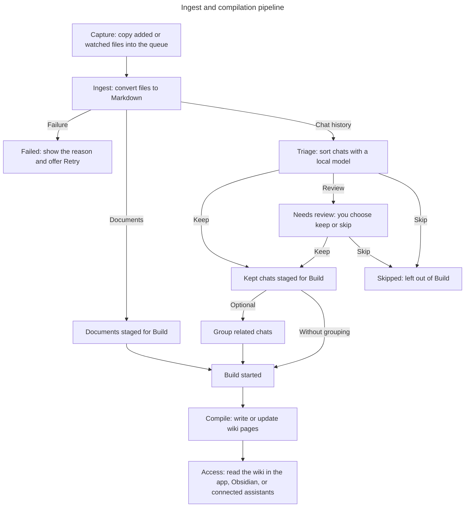
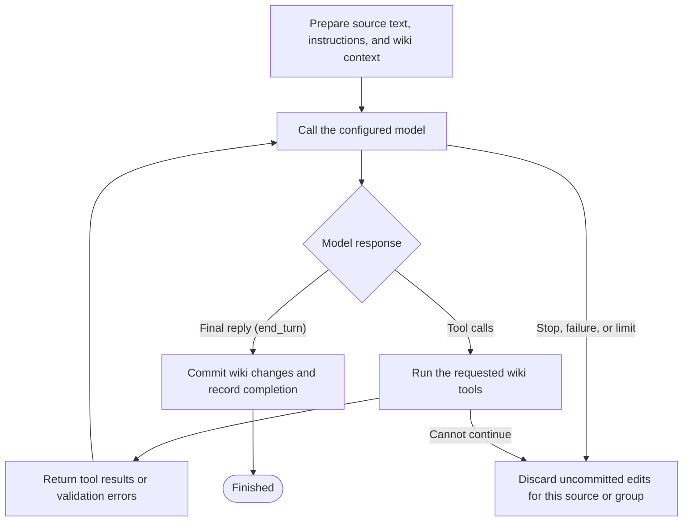

# Architecture

Second Brain is a local-first pipeline that turns scattered source material into one interlinked Markdown wiki. It runs as a short pipeline connected through the filesystem rather than a long-running service: each step reads what the previous one wrote under `~/second-brain/`, so any step can run on its own and the menu bar app is just a thin front end over the same files.

Documents and chat history take different paths:

- **Documents:** capture → ingest → stage → compile → access.
- **Chats:** capture → ingest → triage → stage kept chats → optionally group → compile → access.

**Ingest** converts files to Markdown. **Triage** sorts chats into keep, review, or skip. **Staged** sources are ready to build; **compile** means turning them into wiki pages. Ingestion happens automatically, and compilation starts when you choose **Build wiki**. Only chats go through triage and optional grouping in the default configuration.



Grouping can be previewed before a build or performed when the build starts. Documents compile individually in either case. The [compilation agent loop](#compilation-agent-loop) below shows what happens inside Compile.

## Stages

### Capture

Material enters either by being dropped onto the menu bar window or copied into `~/second-brain/drops/`. The drop zone copies files (never moves them) into a drop folder and validates as it goes. A real ChatGPT export is detected by its JSON shape and routed to the `chatgpt` lane, and everything else goes to `documents`. Watched folders listed in `sources.json` feed the same queue: new and changed files are copied into `drops/<source name>/` before parsing. The manifest remembers the original path and captured hash, keeping filenames stable across edits while preserving the originals.

The app watches drops and enabled source folders while it runs. An optional launchd schedule scans them while the app is closed. Both paths only ingest and stage; building requires an explicit action. Failed copies remain in Ingest with Retry, and unchanged failures are not retried by each automatic scan. A changed original is captured again.

### Ingest

Ingestion converts each source to Markdown under `~/second-brain/raw/`, mirroring the source layout (`raw/documents/`, `raw/chatgpt/`, and so on). The parser is chosen per file:

- PDFs are classified one page at a time. Born-digital pages go to Docling; handwritten or scanned pages go to Chandra. A document that mixes the two is parsed by both and stitched back together in reading order.
- Plain text (`.md`, `.txt`, `.tex`) passes through with light front-matter added.
- A ChatGPT export is split into one Markdown file per conversation.

A SQLite manifest records what has been ingested so unchanged files are skipped on the next run.

### Triage

Bulk chat history is noisy. Conversations can be small talk, one-off lookups, or abandoned tangents, so compilation might be wasted on pages worth nothing. During ingestion (before anything reaches the paid compilation step), a small local model (Gemma, via Ollama) reads each new chat and labels it kept, review, or skip.

Triage only looks at the lanes named in `triage.sources`, which is just ChatGPT by default. A document you dropped yourself never goes through triage at all: dropping it is the curation, so it carries no verdict and flows straight to the build. Chats marked review are copied into `~/second-brain/inbox/` for a manual pass.

Triage never sends an untriaged chat to the build. If Ollama stops responding, triage stops and the remaining chats wait to be triaged on the next run, and a chat the model can't score goes to review for you to decide. If a source vanishes mid-run (you un-ingested it from the app while triage was working), that one source is skipped and the run keeps going.

### Compile

Building the wiki is the only stage that calls a hosted model and thus costs money. Two things happen here: planning, then synthesis.

Planning is optional and exists to fight redundancy. Years of chats might circle the same topics (e.g. multiple conversations talking about gradient descent); compiling each of these on their own is likely to be wasteful and result in overlapping pages that would hinder the quality of the wiki. Thus, a clustering step groups related chats first so a topic can become one page instead of many. It embeds each staged chat locally and groups them. Like triage, clustering only touches the lanes in `clustering.sources` (ChatGPT by default). You can preview a grouping before spending anything, adjust it in the app, and the build honors the plan you reviewed (see [using the app](using-the-app.md#building-the-wiki)). With `clustering.enabled`, a build can also group sources when no reviewed plan exists.

Synthesis is done by a compilation agent: the configured model requests tools, and the compiler runs those tools and returns their results. Each agent conversation handles one document, one chat, or a group of related chats. It writes or updates wiki pages with YAML front matter (page metadata), `[[wikilinks]]`, LaTeX math, and source citations.

#### Compilation agent loop

The compiler supplies the full source text, writing instructions, existing domains (subject tags), and up to 30 of the most-referenced unwritten topics (names linked in the wiki that do not yet have a page). It looks up this context before each conversation, so later conversations see domains introduced by earlier ones. The model can request tools to read or search the wiki, create pages, and edit page bodies or metadata.



After the agent conversation for one document, chat, or chat group ends with `stop_reason: "end_turn"`, the compiler records source hashes, saves a Git checkpoint (see [how the wiki is versioned](lifecycle.md#how-the-wiki-is-versioned)), and adds the changed pages to the "recently updated" list. The build repeats this loop for the next group.

At the end of the build attempt, a deterministic step rebuilds the index, gap list, domain views, and recently-updated list from the saved wiki pages. This happens once per build attempt, including a partial or stopped build.

### Access

The compiled wiki is stored as plain Markdown under `~/second-brain/wiki/`, so it opens directly as an Obsidian vault. An MCP server exposes it to Claude Desktop, ChatGPT Desktop, and Cursor, always offering keyword search and adding embedding-based semantic search when Ollama is available.

## What runs locally versus in the cloud

| Work | Where it runs |
| --- | --- |
| PDF layout and typed-page parsing (Docling) | Local, across MLX and Apple MPS |
| Handwriting and scanned-page OCR (Chandra) | Local, on MLX backend on Apple Silicon |
| Triage classification (Gemma) | Local, via Ollama |
| Semantic-search and clustering embeddings | Local, via Ollama |
| Grouping chats into clusters | Local (threshold or HDBSCAN over embeddings) |
| Wiki synthesis (the build step) | Cloud via the configured provider (Anthropic or DeepSeek) |

Only the build step is required to leave the machine. Everything needed to capture, parse, and filter your material is local and free.

## Where data lives

Everything sits under the vault root, `~/second-brain/`:

```
~/second-brain/
├── drops/          capture queue. Files land here and are removed once ingested
├── raw/            parsed Markdown, one tree per source lane and read during compilation
├── wiki/           the compiled knowledge base (plain Markdown, git-tracked)
├── inbox/          copies of review-tier sources awaiting a manual decision
├── logs/           run logs, including pipeline.log for detached runs
├── manifest.db     ingestion state, page cache, and triage decisions
├── search.db       keyword + embedding index, rebuilt from the wiki
├── sources.json    GUI-managed list of watched folders
└── (dotfiles)      run coordination with the menu bar app — see below
```

`manifest.db` and `search.db` are detailed in [wiki structure](wiki-structure.md#the-two-databases).

A few dotfiles coordinate a run with the menu bar app: `.status.json` (a progress heartbeat), `.build-log.jsonl` (a created/updated history), `.stop` (a cooperative stop flag), and, once you preview clustering, `.clusters.json` plus `.cluster-overrides.json` (the proposed grouping and your tweaks to it, described in [the lifecycle document](lifecycle.md#what-gets-recorded)).

Configuration lives in the repository: `config/config.yaml` holds the pipeline settings and `.env` holds the compilation provider's API key (owner-only, never committed).

## Hashing and caching

Two layers of caching keep repeated work cheap, and both are explained in detail in [the lifecycle document](lifecycle.md):

- Each source is fingerprinted by a content hash so a byte-identical file dropped again, even under a different name, is not reprocessed.
- Each rendered PDF page is fingerprinted by the hash of its image, so re-exporting a notebook after editing one page only re-runs OCR on the page that actually changed.
